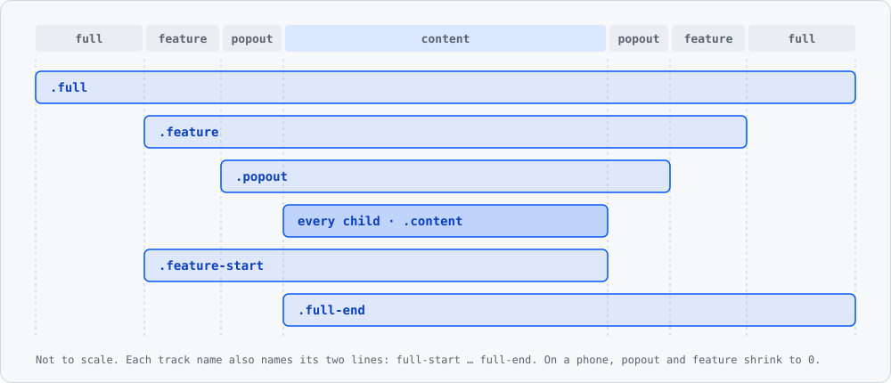

# Breakouts

[](https://www.npmjs.com/package/breakouts)
[](LICENSE)


**One grid, one class per breakout.** Put your content in a `.breakouts` container: every child sits in a centred reading column, and any of them can widen to `popout`, `feature` or `full` with a single class. On a phone the same markup keeps the text off the screen edges, with no media query.

Around the grid sits a deliberately thin layer: colour tokens with light and dark modes, a reset, base typography, a few utilities and three themes. Use all of it, or only the grid.

**[Live demo →](https://cantilux.github.io/breakouts/)**



> [!NOTE]
> Breakouts is in `0.x`. Until `1.0.0`, a minor version may still rename or remove a class, a custom property or a Sass variable; the [changelog](CHANGELOG.md) says which.

## Contents

- [Installation](#installation)
- [The grid](#the-grid)
- [Base styles](#base-styles)
- [Colour tokens and modes](#colour-tokens-and-modes)
- [Utilities](#utilities)
- [Themes](#themes)
- [Customisation](#customisation)
- [Browser support](#browser-support)
- [Principles](#principles)
- [Workflow](#workflow)
- [Credits and licence](#credits-and-licence)

## Installation

```sh
npm install breakouts
# or: pnpm add breakouts · yarn add breakouts · bun add breakouts
```

### With Sass

The Sass sources let you configure everything at build time. They use the module system (`@use`, `@forward`), so they need **Dart Sass**: LibSass and Ruby Sass cannot read them.

```scss
@use 'pkg:breakouts';   // tokens, reset, typography, grid, utilities
```

The `pkg:` URL needs Sass's Node package importer (Dart Sass 1.71 or newer): `--pkg-importer=node` on the command line, or in JavaScript:

```js
import * as sass from 'sass'

sass.compile('style.scss', { importers: [new sass.NodePackageImporter()] })
```

Without it, add `node_modules` to the load paths (`--load-path=node_modules`) and drop the prefix: `@use 'breakouts';`.

### Plain CSS

No Sass? The package ships the full bundle, built with the default settings:

```html
<link rel="stylesheet" href="node_modules/breakouts/dist/breakouts.css">
<!-- or from a CDN, pinned to a minor version -->
<link rel="stylesheet" href="https://cdn.jsdelivr.net/npm/breakouts@0.8/dist/breakouts.min.css">
```

```js
import 'breakouts/dist/breakouts.css'   // bundlers; breakouts.min.css is the minified build
```

### Entry points

Every entry point emits its layers in the same order, so you can stop at the size you need:

| `@use` | Emits | Use it when |
| --- | --- | --- |
| `'pkg:breakouts'` | Everything below, utilities last | You want the whole kit |
| `'pkg:breakouts/src/base'` | Colour tokens, reset, typography, grid | You want the defaults but write your own utilities |
| `'pkg:breakouts/src/core'` | Colour tokens and grid | You have your own reset and typography |
| `'pkg:breakouts/src/base/layout'` | The grid and its custom properties only | You want nothing but the layout |
| `'pkg:breakouts/src/reset'` | The reset only | |
| `'pkg:breakouts/src/utilities'` | Colour, spacing, position and typography utilities | Next to `core` or `base`: the colour utilities read the `--color-*` tokens |

### First page

```html
<article class="breakouts">
  <h1>Field notes</h1>
  <p>Text stays in the reading column.</p>
  <figure class="popout">A slightly wider figure</figure>
  <pre class="feature">A wide code block</pre>
  
  <aside class="feature-start">A note pulled out to the start side</aside>
</article>
```

## The grid

`.breakouts` is a CSS grid with seven column tracks between named lines, after Ryan Mulligan's [Layout Breakouts with CSS Grid](https://ryanmulligan.dev/blog/layout-breakouts/):

```text
[full-start]    --full     [feature-start] --feature [popout-start] --popout
[content-start] --content  [content-end]
--popout [popout-end] --feature [feature-end] --full [full-end]
```

Every direct child goes into `content`. A placement class moves it out to a wider pair of lines:

| Class | Spans | |
| --- | --- | --- |
| *(none)*, `.content` | `content` | The reading column |
| `.popout` | `popout` | Content plus `--popout` on each side |
| `.feature` | `feature` | Popout plus `--feature` on each side |
| `.full` | `full` | Edge to edge of the container |
| `.popout-start`, `.feature-start`, `.full-start` | From that area's start line to `content-end` | One-sided: out on the start side only |
| `.popout-end`, `.feature-end`, `.full-end` | From `content-start` to that area's end line | One-sided: out on the end side only |
| `.popout-left`, `.feature-left`, `.full-left` | As `-start` | Physical aliases |
| `.popout-right`, `.feature-right`, `.full-right` | As `-end` | Physical aliases |

The placement classes work on direct children of a `.breakouts` (or `.breakouts-grid`, an alias kept for older markup). Rows are spaced by `row-gap: var(--gap)`, so headings and paragraphs that are direct children lose their block margins and the two do not add up; a spacing utility such as `my-4` still sets them.

### Sizes

Each track is a custom property on `:root`:

```css
:root {
  --gap: clamp(1rem, 6vw, 3rem);              /* row gap, and the smallest outer gutter */
  --full: minmax(var(--gap), 1fr);            /* whatever is left, never less than --gap */
  --feature: minmax(0, 5rem);
  --popout: minmax(0, 2rem);
  --content: min(50ch, 100% - var(--gap) * 2);
}
```

`popout` and `feature` can shrink to nothing, `full` never below `--gap`. As the container narrows, the wide areas give way first and the text never touches the edge. With the default `system-ui` font at 16px, measured in Chromium:

| Viewport | `--gap` | `content` | `.popout` | `.feature` | `.full` |
| --- | --- | --- | --- | --- | --- |
| 375px | 22.5px | 330px | 330px | 330px | 375px |
| 768px | 46px | 504px | 568px | 676px | 768px |
| 1440px | 48px | 504px | 568px | 728px | 1440px |

Below about 573px, `.popout` and `.feature` are as wide as the text; from about 824px every area has its full size. `50ch` is measured in the font of the `.breakouts` element, so another font or size moves these numbers.

To change the proportions, override the properties on any element, not only `:root`:

```css
.longform {
  --content: min(65ch, 100% - var(--gap) * 2);   /* keep the gutter term */
  --feature: minmax(0, 8rem);
}
```

### Nesting

A `.breakouts` that is a direct child of another `.breakouts` becomes a [`subgrid`](https://developer.mozilla.org/docs/Web/CSS/CSS_grid_layout/Subgrid) of it: its columns are the parent's columns, so nested content lines up with the outer text.

```html
<section class="breakouts">
  <p>Outer text</p>
  <div class="feature breakouts">
    <p>Lines up with the outer text</p>
    <figure class="popout">Lines up with an outer .popout</figure>
      <!-- as wide as the nested .feature -->
  </div>
</section>
```

A class that reaches past the nested area fills that area: `.full` inside a nested `.feature` is as wide as the `.feature`. A browser without subgrid gives the nested grid its own tracks instead, sized to the nested area.

### Older helpers

These predate the grid. They keep working, and they are not developed further.

| Class | What it does |
| --- | --- |
| `.container` | Centred wrapper: `max-width: 72rem`, `padding-inline: 1rem` |
| `.grid` | Three columns with the children in the middle one, `minmax(0, var(--container-max-width, 64rem))` wide, and `gap: var(--gap)` |
| `.grid--full` | On a `.grid`: the children span all three columns |
| `.full-bleed` | `100vw` wide, pulled out to the viewport's left edge; the parent must be centred in the viewport |
| `.full-bleed--left`, `.full-bleed--right` | From that viewport edge to the parent's opposite edge |
| `.breakout`, `.breakout--left`, `.breakout--right` | Deprecated aliases of `.full-bleed*`, removed in the next major version |

`100vw` includes a classic scrollbar, so a page using `.full-bleed` may need `overflow-x: clip` on `body`. Inside a `.breakouts`, prefer `.full`: it needs neither.

## Base styles

In the full bundle and in `src/base`, not in `src/core`.

- **Reset.** `box-sizing: border-box` on every element and pseudo-element, and **every margin and padding set to 0**, lists included: give `ul` and `ol` a `padding-inline-start` if you want the bullets inside the box. `html` and `body` get `width: 100%`.
- **Body.** `system-ui, sans-serif`, `1rem`, `line-height: 1.6`, `var(--color-text)` on `var(--color-background)`.
- **Headings.** `font-weight: 600`, `line-height: 1.2`, `margin: 2rem 0 1rem`, `var(--color-text)`; sizes `h1` 2.25rem · `h2` 1.75rem · `h3` 1.5rem · `h4` 1.25rem · `h5` 1.125rem · `h6` 1rem.
- **Paragraphs** `margin: 1rem 0`. **Links** `var(--color-primary)`, underlined, `var(--color-secondary)` on hover.

## Colour tokens and modes

Every colour is a custom property, so your own CSS can use them:

| Token | Light | Dark |
| --- | --- | --- |
| `--color-background` | `#ffffff` | `#111111` |
| `--color-surface` | `#f0f0f0` | `#1a1a1a` |
| `--color-text` | `#111111` | `#eeeeee` |
| `--color-muted` | `#666666` | `#aaaaaa` |
| `--color-primary` | `#0055ff` | The light value, 50% lighter |
| `--color-secondary` | `#0033aa` | The light value, 50% lighter |
| `--color-accent` | `#ff4081` | The light value, 50% lighter |
| `--color-success` | `#28a745` | The light value, 50% lighter |
| `--color-error` | `#dc3545` | The light value, 50% lighter |
| `--color-warning` | `#ffc107` | The light value, 50% lighter |
| `--color-neutral-100` … `-900` | `#f8f9fa` … `#212529` | The same in every mode |

"50% lighter" is Sass's `color.scale($lightness: 50%)`: brand and status colours stay readable on a dark background, and changing a light value changes its dark value too.

Which values apply:

| Markup | Mode |
| --- | --- |
| `<html>` | Follows the system: dark when `prefers-color-scheme: dark` |
| `<html class="dark">` | Always dark |
| `<html class="light">` | Always light, even on a dark system |

Each mode also sets `color-scheme`, so form controls and scrollbars match.

`.dark` and `.light` work on any element, not only `<html>`: they redefine the tokens for that subtree. Text that inherits its colour from `body` keeps the page's colour, though, so give the element its own background and text colour:

```html
<section class="dark bg-background text-color">…</section>
```

## Utilities

Optional, and always emitted last: on equal specificity a utility beats the grid and the base styles, so `class="container px-0"` removes the container's padding.

| Group | Classes |
| --- | --- |
| Background | `bg-background`, `bg-surface`, `bg-primary`, `bg-secondary`, `bg-accent`, `bg-muted`, `bg-success`, `bg-error`, `bg-warning` |
| Text colour | `text-color` (`--color-text`), `text-background`, `text-surface`, `text-primary`, `text-secondary`, `text-accent`, `text-muted`, `text-success`, `text-error`, `text-warning`, `text-neutral-100` … `text-neutral-900` |
| Margin | `m-*`, `mt-*`, `mr-*`, `mb-*`, `ml-*`, `mx-*`, `my-*` |
| Padding | `p-*`, `pt-*`, `pr-*`, `pb-*`, `pl-*`, `px-*`, `py-*` |
| Position | `position-static`, `position-relative`, `position-absolute`, `position-fixed`, `position-sticky` |
| Stacking | `z-index-0`, `z-index-1`, `z-index-10`, `z-index-100`, `z-index-1000` |
| Text align | `text-left`, `text-center`, `text-right`, `text-justify` |
| Text case | `text-uppercase`, `text-lowercase`, `text-capitalize` |
| Font | `font-bold`, `font-normal`, `italic`, `not-italic` |
| Line height | `leading-tight` (1.25), `leading-normal` (1.5), `leading-loose` (2) |

The `*` in the spacing classes is a step of `$space-scale`:

| Step | `0` | `1` | `2` | `3` | `4` | `5` | `6` | `auto` |
| --- | --- | --- | --- | --- | --- | --- | --- | --- |
| Value | `0` | `0.25rem` | `0.5rem` | `0.75rem` | `1rem` | `1.25rem` | `1.5rem` | `auto`, margins only |

So `mx-auto` centres a block and `py-4` adds `1rem` above and below. The spacing utilities use physical sides (`margin-left`, `padding-top`): `ml-*` is the left side in every writing direction.

## Themes

A theme is a set of colours plus the modules that use them. Load it **before** the main entry point:

```scss
@use 'pkg:breakouts/src/theme/chupa-pop';
@use 'pkg:breakouts';
```

| Theme | Module | Colours |
| --- | --- | --- |
| Chupa Pop | `src/theme/chupa-pop` | Primary `#ecb838`, secondary `#ab4073`, accent `#196484` |
| Medical | `src/theme/medical` | Primary `#4682b4`, secondary `#9dc183`, accent `#a9a9a9`, muted `#6b7280`, background `#ffffff` |
| Tootsie Pop | `src/theme/tootsie-pop` | Primary `#93329e`, secondary `#f2711c`, accent `#e94057`, muted `#ffe5b4`; text `#fff5e6` on background `#4f2f4c`, dark in every mode |

The second `@use` matters: on its own, a theme emits the tokens, reset, typography, grid, colour and typography utilities, but **not the spacing and position utilities**.

A theme takes its own variables: `$primary`, `$secondary` and `$accent`; Medical and Tootsie Pop also `$muted` and `$background`; Tootsie Pop also `$text`.

```scss
@use 'pkg:breakouts/src/theme/chupa-pop' with ($accent: #0f766e);
@use 'pkg:breakouts';
```

A theme has already configured the variables, so `@use 'pkg:breakouts' with (…)` after a theme is a compile error: configure the theme instead.

## Customisation

### At build time

Every variable below is `!default`, so `@use … with (…)` sets it on first load:

```scss
@use 'pkg:breakouts' with (
  $color-primary: #7c3aed,                               // dark mode gets a lighter tint for free
  $color-primary-dark: #c4b5fd,                          // or pick it yourself
  $font-family-base: ('Inter', system-ui, sans-serif),   // a list needs parentheses here
  $space-scale: (0: 0, 1: 0.25rem, 2: 0.5rem, 4: 1rem, 8: 2rem, auto: auto),
);
```

| Variables | Default |
| --- | --- |
| `$color-{name}` for `background`, `surface`, `text`, `muted`, `primary`, `secondary`, `accent`, `success`, `error`, `warning` | The light column of the [token table](#colour-tokens-and-modes) |
| `$color-{name}-dark` | The dark column |
| `$color-{name}-light` | `$color-{name}`: what `.light` applies |
| `$color-neutral-100` … `$color-neutral-900` | `#f8f9fa` … `#212529` |
| `$font-family-base`, `$font-size-base`, `$line-height-base` | `system-ui, sans-serif`, `1rem`, `1.6` |
| `$headings` | `(h1: 2.25rem, h2: 1.75rem, h3: 1.5rem, h4: 1.25rem, h5: 1.125rem, h6: 1rem)` |
| `$space-scale` | `(0: 0, 1: 0.25rem, 2: 0.5rem, 3: 0.75rem, 4: 1rem, 5: 1.25rem, 6: 1.5rem, auto: auto)` |

`$headings` and `$space-scale` **replace** the default map: list every level you want. `$headings: (h1: 3rem)` styles `h1` and leaves `h2`–`h6` without heading styles.

### At runtime

The grid tracks and the colours are custom properties, so plain CSS changes them on any element, no Sass needed:

```css
.longform { --content: min(60ch, 100% - var(--gap) * 2); }
```

The colour modes set the tokens with more specific selectors than `:root` (up to `:root:not(.light):not(.dark)`), so a colour set on `:root` only reaches the default light mode. Load your rules after Breakouts and match each mode's selector:

```css
:root, :root.light, .light { --color-primary: #7c3aed; }
:root.dark, .dark { --color-primary: #c4b5fd; }
@media (prefers-color-scheme: dark) {
  :root:not(.light):not(.dark) { --color-primary: #c4b5fd; }
}
```

For colours, the Sass variables are simpler: one value, and the build writes every mode.

## Browser support

Every current browser. The grid relies on `min()`, `clamp()`, named grid lines and `:is()`; nesting relies on `subgrid` (Chrome and Edge 117, Firefox 71, Safari 16), and older browsers fall back to a nested grid with its own tracks.

## Principles

- **The grid is the product.** Everything else is a thin, optional layer around it, and stays thin.
- **One class, one placement.** No column counts and no breakpoints in the markup: the tracks resize themselves.
- **ITCSS order.** Settings, reset, element styles, layout, utilities: every entry point emits its layers in that order, so a later layer wins on equal specificity.
- **Flat, low specificity.** Plain class selectors, no IDs, no `!important`. Your CSS wins without a fight.
- **Custom properties first.** Sass configures the defaults; custom properties change them per page or per section after the build.
- **Not utility-first.** A small set of utilities for the last adjustments, not a vocabulary to build pages with.

## Workflow

### Setup

```sh
git clone https://github.com/Cantilux/breakouts.git
cd breakouts
npm install
```

| Command | What it does |
| --- | --- |
| `npm run build` | Compiles `src/_index.scss` into `dist/breakouts.css` and `dist/breakouts.min.css`, then copies the readable build to `docs/breakouts.css` |
| `npm test` | Compiles every entry point and every theme, then imports the package the way a consumer would and checks the output |
| `npm run changeset` | Records a change for the next release |
| `npm run release:version` | Applies the pending changesets: new version and `CHANGELOG.md` entry (the release train runs it, not people) |

The demo is the static page `docs/index.html`: open it in a browser after `npm run build` and check the examples at a phone width and at a wide one.

### Making a change

1. **Branch from `master`** (from `hotfix` for an urgent fix, see [Releasing](#releasing)), named after the kind of change: `feat/…`, `fix/…`, `docs/…`. `master` is protected: changes reach it only through a pull request.
2. **Commit with [Conventional Commits](https://www.conventionalcommits.org/)**: `feat:`, `fix:`, `docs:`, `refactor:`, `test:`, `chore:`, `ci:`, with a scope when it helps (`fix(layout):`).
3. **Rebuild.** `dist/` and `docs/breakouts.css` are committed: run `npm run build` and commit them with the sources.
4. **Add a changeset** with `npm run changeset` when the change affects what users get. The public API is the class names, the custom property names and the `!default` variable names:

   | Bump | When |
   | --- | --- |
   | `patch` | Fixes that keep every class, custom property and variable working as before |
   | `minor` | New classes, custom properties, variables or themes |
   | `major` | A renamed or removed class, custom property or variable (while in `0.x`: `minor`) |

5. **Open a pull request.** CI (`Test, build`) runs the tests and the build, fails if the committed `dist/` or `docs/breakouts.css` differ from a fresh build, and lists what npm would publish. Merging needs a green CI. If you change a class, a custom property or a variable, update this README and `docs/index.html` in the same pull request.

### Releasing

Releases leave on a schedule, never from a laptop. Merge pull requests into `master` whenever they are ready, each with its changeset; nobody bumps versions by hand.

| Branch | Role |
| --- | --- |
| `master` | Work for the next scheduled release |
| `release` | What is on npm and on the demo site; only the release train (and admins) may push to it, and every push publishes |
| `hotfix` | Starts from `release`; urgent fixes merged here ship at once |

1. **Every Thursday around 12:00 (Rome time)** the **Release train** workflow takes `master`. With no pending changesets it stops. Otherwise it runs `npm run release:version` (new version, `CHANGELOG.md` entry), the tests, the build and the package check, pushes the `chore: release x.y.z` commit to `master`, fast-forwards `release` to it and moves `hotfix` there too.
2. **The push to `release`** starts the **Release** workflow: it sees a version npm does not have yet, runs the checks again, publishes with npm trusted publishing (with provenance) and tags `vX.Y.Z`. The same push starts **Docs**, which deploys the demo site from `release`, so it always matches what is on npm.
3. **Hotfix:** open a pull request into `hotfix` with a `patch` changeset (CI rejects `minor` and `major` there) and merge it. The train releases `hotfix` right away the same way, then merges it back into `master`; if that merge conflicts, it opens a pull request to resolve, and the Thursday train waits for it. Never land the same fix in `master` too: it gets there through the merge back.
4. **Out of schedule:** a maintainer can start the train by hand from Actions > Release train > Run workflow, choosing `master` or `hotfix`. It does exactly what the scheduled run does.

A pull request with no changeset ships nothing: with no pending changesets the train stops, so npm keeps the old version and the demo site, which deploys only from `release`, keeps the old page. Changes to the README or to `docs/` count: the README ships in the package, so they take a `patch` changeset like any fix.

The train refuses to release when `release` has commits its source branch lacks, and a branch that moved while it ran makes it stop; it is safe to run again. Its git pushes use the `RELEASE_DEPLOY_KEY` deploy key, the bypass actor of the rulesets on `master`, `hotfix` and `release` (GitHub does not let the workflow token bypass rulesets, and its pushes would not start **Release**). npm never sees the key: publishing uses trusted publishing.

Run `npm pack --dry-run` to see exactly what npm would receive.

## Credits and licence

The named-line grid comes from Ryan Mulligan's article [Layout Breakouts with CSS Grid](https://ryanmulligan.dev/blog/layout-breakouts/) (2022). Breakouts packages it with one-sided variants, nesting and a small toolkit around it.

Released under the [MIT licence](LICENSE), © 2025 Enrico Cantile.
